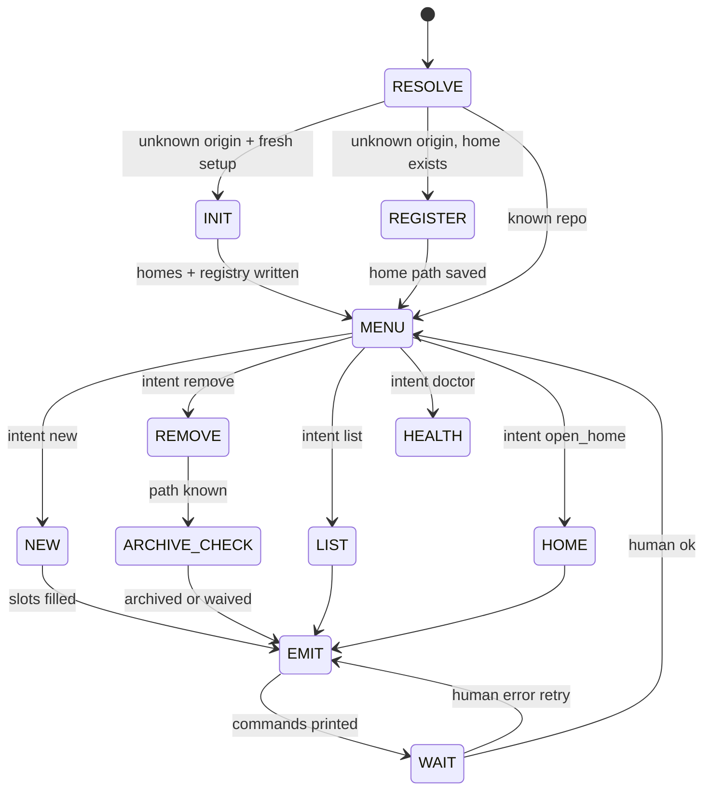

# wt-workflow FSA

States are **agent conversation states**, not plugin internals.

## State: RESOLVE

**Inputs:** `origin_url?`, `cwd?`, `registry.yaml`

**Outputs:** `repo_id`, `home_path`, `wt_group`

**Transition:**

- `origin` in registry → **MENU**
- else if home missing or user asked fresh setup → **INIT**
- else → **REGISTER**

## State: INIT (INIT_HOME)

One-time (or batch) bring-up: canonical home + registry. See `layout.md` (`gitlab_path_mirror` policy).

**Inputs:** one or more `origin` URLs; optional `layout_policy` (default `gitlab_path_mirror`).

**Agent may run (INIT only):**

- `layout-from-origin.py` per URL
- `mkdir -p` parent of each `home`
- `git clone` into `home` when no `.git` (non-destructive; skip if directory exists)
- `git -C home remote get-url origin`, detect `default_branch` (`symbolic-ref refs/remotes/origin/HEAD` or `main`)

**Agent writes:** `registry.yaml` entry per repo (`repo_id`, `origin`, `gitlab_path`, `org`, `repo`, `home`, `wt_group`, `default_branch`).

**Human still runs:** `wt init` / `wt edit` / bare `wt` (plugin interactivity).

**Preflight (agent or emit):** DNS + SSH reachability for the git host when using `git@host:…` URLs.

**Clone URL:** prefer SCP/SSH form when HTTPS fails or SSH auth is already configured.

**Dotfiles boundary:** write `repos` only to `~/.cursor/wt-registry/registry.yaml` on the machine. Never commit employer- or client-specific origins, paths, or registry entries to chezmoi/dotfiles.

→ **MENU** (or end batch)

## State: REGISTER

**Elicit (in order, stop when filled):**

1. `origin` URL (normalize `git@github.com:org/repo.git` ↔ `https://...`)
2. Run `layout-from-origin.py`; confirm `gitlab_path`, `home`, `wt_group`, `repo` (basename)
3. Override only if user rejects defaults (`~/src/{gitlab_path}`, `~/wt/{gitlab_path}`)

**Emit:** agent edits `registry.yaml` after confirm (no `wt register` subcommand yet).

→ **MENU**

## State: MENU

**Elicit:** one intent keyword or number.

→ intent state

## State: NEW (NEW_WORKTREE)

**Slots:**

| Slot | Required | Default |
|------|----------|---------|
| `branch` | yes | — |
| `base` | no | `main` |
| `worktree_name` | no | basename of repo or branch slug (typed at `wt init` prompt) |

**Guard:** refuse if target is the home checkout (not a leaf under `wt_group`).

**Emit:** `wt init` with `--worktree-root $wt_group`, `--branch`, `--ref`, `--repos` (see `wt-commands.md`). Warn: fzf/vared prompts for repo pick and worktree **name**.

→ **EMIT**

## State: LIST

**Emit:** `wt status` optional `--worktree-root $wt_group`

→ **EMIT**

## State: HEALTH

**Emit:** `wt doctor` optional `--worktree-root` / `--suggest`

→ **EMIT**

## State: REMOVE (REMOVE_WORKTREE)

**Slots:** `wt_group` (from registry); you select leaves in `wt edit` fzf

**Guard:** never target `home_path`

→ **ARCHIVE_CHECK**

## State: ARCHIVE_CHECK

**Agent must ask:** "Archive Cursor chats for this path into repo memory before remove?"

- yes → follow repo-memory **Archive session** (per selected checkout); then **EMIT** `wt edit --worktree-root $wt_group`
- waive → you confirm in writing ("skip archive") → **EMIT**
- defer → stay until archive done

## State: EMIT

Print `wt` commands. No `git worktree`. (`git clone` only in **INIT**.)

→ **WAIT**

## State: WAIT

Human: `ok` | error text | cancel

- `ok` → **MENU** or end
- error → **EMIT** with adjusted args if known, else back to elicit
- cancel → end
